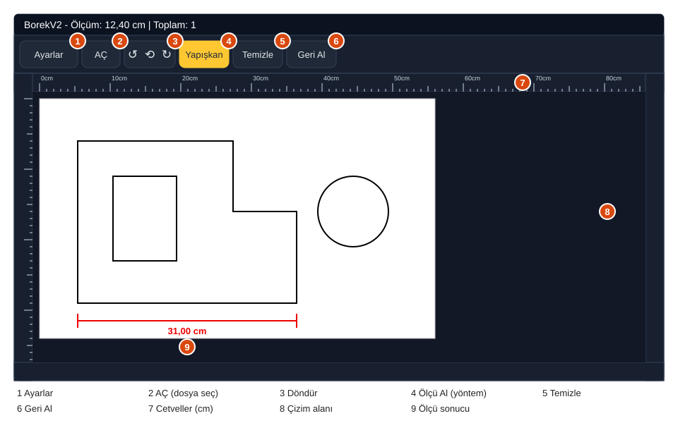
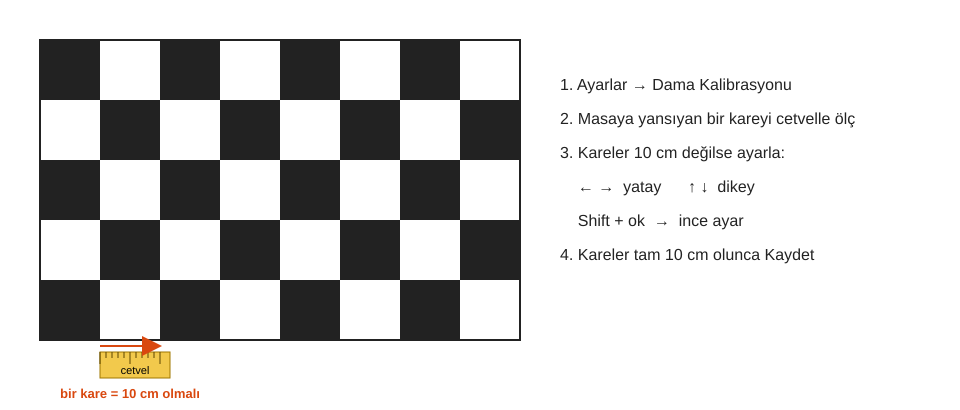
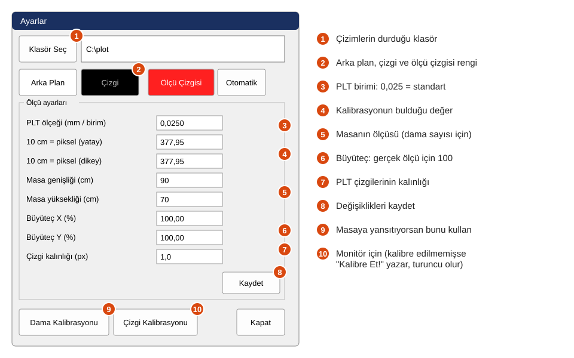
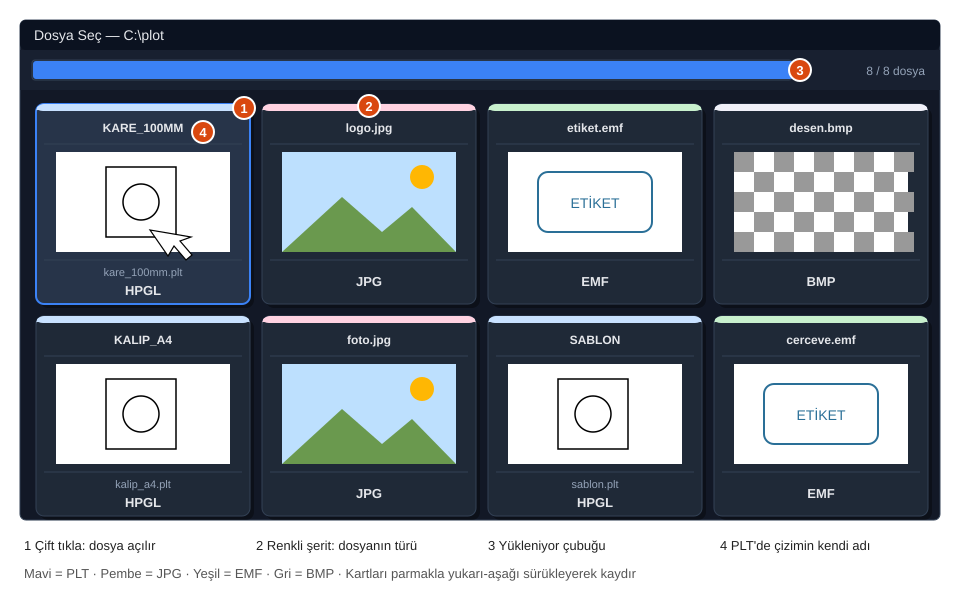
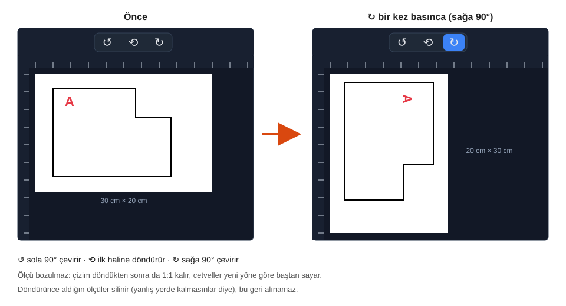
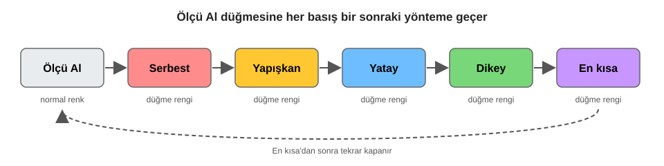
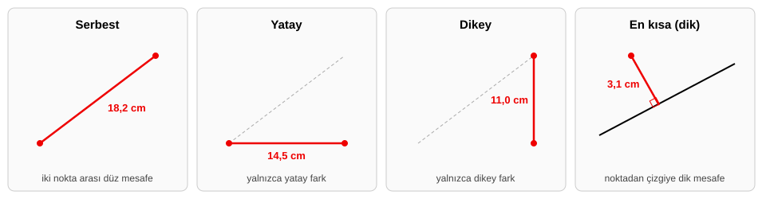
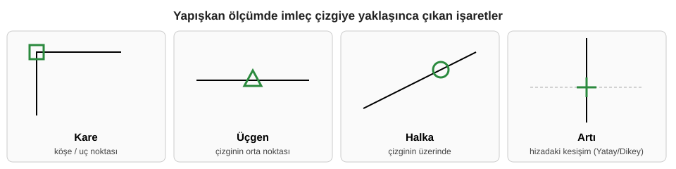

# BorekV2

**[⬇ Son sürümü indir](https://github.com/hbickin/BorekV2/releases/latest)** · [Neler değişti?](CHANGELOG.md)

## Kullanım Kılavuzu

BorekV2, `.plt` çizimlerini ve `.jpg`, `.bmp`, `.emf` resimlerini ekranda ya da masaya yansıttığın görüntüde **birebir gerçek ölçüsünde** gösterir. Yani ekranda 10 cm görünen çizgiyi masada cetvelle ölçersen gerçekten 10 cm çıkar.

> Bu kılavuz 2.8.x sürümü için. Resimler ekranın basitleştirilmiş hali. Hangi sürümü kullandığını açılış ekranında görebilirsin.



---

## 5 dakikada başla

Acelen varsa sadece bunu oku, gerisine takıldıkça bakarsın.

1. **Kur ve aç.** Kurulumu çalıştır, son ekranda "BorekV2'yi şimdi başlat" işaretliyse program kendisi açılır. Sonraki seferlerde **Başlat** menüsünden aç (ayrıntısı 1. bölümde).
2. **İlk Adımlar penceresi açılır.** Henüz kalibrasyon yapmadıysan program seni kendisi karşılar. Dört adım var, biten adımın yanında ✓ çıkar. Adımlar sırayla açılır: bir öncekini bitirmeden sonrakinin düğmesi soluk kalır. Kapattıysan **Ayarlar → İlk Adımlar** ile yine açarsın.
3. **Klasörünü seç.** **Klasör Seç**'e bas, çizimlerinin durduğu klasörü göster.
4. **Kalibre et.** **Dama Kalibrasyonu**'na bas. Masaya kareler yansır, birini cetvelle ölç, oklarla tam 10 cm yap ve **Kaydet**. Monitörde çalışıyorsan alttaki "Çizgi kalibrasyonu" bağlantısını kullan.
5. **Bir çizim aç.** **AÇ**'a bas, dosyana çift tıkla. Elinde dosya yoksa "10 cm'lik deneme karesini aç" bağlantısına dokun: 10×10 cm'lik bir kare ve içinde 5 cm'lik bir daire gelir.
6. **İlk ölçümü al.** **Ölçü Al**'a bas, karenin bir köşesine sonra öbür köşesine dokun. **100 mm** çıkmalı. Masada da cetvelle 10 cm tutuyorsa tamamsın.

Dört adım da bitince pencere "Hazırsın!" der ve "Açılışta bir daha gösterme" kendiliğinden işaretlenir. Kutuyu boş bırakırsan, kalibrasyon yapılmadığı sürece her açılışta yine gelir.

---

## 1. Kurulum

1. [Son sürümü buradan indir](https://github.com/hbickin/BorekV2/releases/latest), `BorekV2_Setup_v2.x.x.x.exe` dosyasını çalıştır.
2. Windows "bilinmeyen yayımcı" diye uyarırsa korkma: **Ek bilgi → Yine de çalıştır** de.
3. Kurulum sana masaüstüne kısayol isteyip istemediğini sorar. Kutu boş gelir; masaüstünde simge istiyorsan işaretle.
4. Kurulum bitince program açılır. Sonra **Başlat** menüsünden (ya da masaüstü kısayolundan) açarsın.

### Ne lazım?

| | |
|---|---|
| İşletim sistemi | Windows 10 ya da 11, 64 bit |
| .NET | .NET 10 Masaüstü Çalışma Zamanı (Desktop Runtime). Yoksa program ilk açılışta Windows'un "indir" penceresini gösterir, oradan kur ve programı tekrar aç. |
| Ekran | 1280×800 ve üstü rahat eder, daha küçükte araç çubuğu kendini küçültür. Masaya yansıtıyorsan projektörü Windows'ta **Çoğalt** ya da **Yalnızca ikinci ekran** yap. |
| Disk | Program birkaç MB. .NET de kurulacaksa 200 MB kadar boş yer ayır. |
| İnternet | Sadece yeni sürüm kontrolü için. İnternet yoksa program yine çalışır. |
| Dokunmatik / kalem | Şart değil, varsa ölçerken kullanabilirsin (5. bölüm) |

**Güncelleme:** Program her açılışta yeni sürüm var mı diye bakar. Varsa bir pencere açılır ve **neler değiştiğini** gösterir. **Şimdi güncelle**'ye basarsan yeni kurulum indirilir (yüzde kaçta olduğunu görürsün), program kapanır ve kurulum açılır; eskisinin üstüne kurman yeterli, ayarların ve kalibrasyonun silinmez. **Sürüm sayfası** aynı notları tarayıcıda açar, **Sonra** pencereyi kapatır ve bir sonraki açılışta yine sorar. İnternet yoksa hiçbir şey çıkmaz, program normal çalışır.

Beklemek istemiyorsan **Ayarlar → Güncelleme Var mı?**'ya bas. Yeni sürüm varsa aynı pencere açılır ve indirme kendiliğinden başlar. Yoksa köşede "En son sürümü kullanıyorsun" yazar.

### Kaldırmak istersen

1. **Başlat → BorekV2 → BorekV2 Kaldır**'a bas. Ya da Windows **Ayarlar → Uygulamalar → Yüklü uygulamalar**'da BorekV2'yi bulup **Kaldır** de.
2. Program dosyaları silinir. Ayarların (kalibrasyon, tema, klasör) ve hata kayıtların ise bilgisayarda kalır, yeniden kurarsan kaldığın yerden devam edersin.

Her şeyi tamamen silmek istiyorsan bunlar da var:

- **Hata kayıtları ve deneme çizimi:** `Win + R`'ye bas, `%LOCALAPPDATA%\BorekV2` yaz, açılan klasörü sil.
- **Ayarlar:** `Win + R` → `regedit` → `HKEY_CURRENT_USER\SOFTWARE\BorekV2` anahtarını sil. Kayıt defterinde başka bir şeye dokunma.

---

## 2. İlk iş: kalibrasyon (bir kere yapman yeter)

Programın ölçüyü doğru göstermesi için senin ekranında ya da projektöründe 1 cm'nin kaç piksel olduğunu bilmesi lazım. Henüz kalibre etmediysen ana ekrandaki düğme turuncu olur ve **Ayarlar (!)** yazar, oradan anlarsın. Ayarlar penceresinde de **Kalibre Et!** düğmesi turuncu görünür.

**Ayarlar** penceresinde iki yol var:

### Dama kalibrasyonu (masaya yansıtıyorsan bunu kullan)
1. **Ayarlar → Dama Kalibrasyonu**'na bas. Masaya 10×10 cm'lik kareler yansır.
2. Bir kareyi cetvelle ölç. 10 cm değilse ok tuşlarıyla büyütüp küçült: ← → yatay, ↑ ↓ dikey. İnce ayar için Shift'e basılı tut. Klavye uzaktaysa ortadaki paneldeki **Yatay −/+** ve **Dikey −/+** düğmeleri de aynı işi yapar.
3. Kareler tam 10 cm olunca yeşil **Kaydet** düğmesine bas. Bu kadar.

Kaç kare yansıyacağı **Ayarlar**'daki masa genişliği ve yüksekliğine göre belirlenir. Masan 90×70 cm ise 9×7 kare görürsün.



### Çizgi kalibrasyonu (monitörde çalışıyorsan)
1. **Ayarlar → Çizgi Kalibrasyonu**'na bas.
2. Ekrandaki A (yatay) ve B (dikey) çizgilerini cetvelle ölç, kaç mm çıktığını yaz ve **Çizgilerden hesapla**'ya bas. Cetvelin sıfırını çizginin ucundaki çentiğe daya. İstersen bunun yerine monitörün kaç inç olduğunu girip **Monitörden hesapla** da diyebilirsin, ama o biraz daha kaba sonuç verir.
3. **Kaydet**. Baştan başlamak istersen "Varsayılan (96 DPI)" düğmesi var.

Ayar bilgisayarda kalır. Projektörün yerini, yüksekliğini, yakınlaştırmasını ya da Windows'un ekran ölçeklendirmesini (%100, %125 gibi) değiştirmedikçe bir daha uğraşmana gerek yok. Bunlardan biri değişirse kalibrasyonu tekrar yap.

### Ayarlar penceresinde neler var?



Bir alanın ne işe yaradığını unuttuysan fareyle alanın üstüne gel, kısa bir açıklama ve önerilen değer çıkar, fareyi çekince kaybolur. Parmakla çalışıyorsan alana dokunman yeter, sen değeri girerken açıklama alanın altında durur. Ayarlar'daki öteki düğmelerin de üstüne gelince ne yaptığını söyleyen ipucu var.

| Alan | Ne işe yarar? | Önerilen |
|---|---|---|
| PLT ölçeği | Dosyada 1 birim kaç mm | 0,025 (0 = dosyadan otomatik) |
| 10 cm = piksel | Kalibrasyonun sonucu, yatay ve dikey | Dama Kalibrasyonu'nun bulduğu |
| Masa genişliği / yüksekliği | Dama ekranında kaç kare çıkacağı | Masanın gerçek ölçüsü |
| Büyüteç X / Y | Çizimi yüzde olarak büyütüp küçültür | 100 |
| Çizgi kalınlığı | Çizgilerin ekrandaki kalınlığı | 1 (projektörde 2–3) |
| Yapışma (fare/kalem) | Ölçerken çizgiye ne kadar yakından yapışılacağı | 20 |
| Yapışma (parmak) | Aynısı, parmakla dokunurken | 40 |

Sayıların altında bir **uyarı satırı** var. Bir değer tuhaf görünürse (örneğin büyüteç 100 değilse, PLT ölçeği standart dışıysa ya da yatay ve dikey kalibrasyon birbirinden çok farklıysa) burada turuncu yazıyla ne olacağını söyler. Birden fazla uyarı varsa satıra dokununca hepsini görürsün. Uyarı seni durdurmaz, bilerek yaptıysan Kaydet'e basabilirsin.

İşler iyice karıştıysa **Varsayılan Değerler**'e bas: bütün ölçü ayarları ilk kurulumdaki haline döner (PLT ölçeği 0,025, 10 cm = 378 piksel, masa 70×90 cm, büyüteç 100, çizgi 1, yapışma 20/40, pencere boyutu %80). Hemen uygulanır ve kaydedilir. Kalibrasyon da sıfırlandığı için ekrandaki ölçümler silinir ve **kalibrasyonu yeniden yapman** gerekir.

Sayıları değiştirdikten sonra **Kaydet**'e basmayı unutma. Kalibrasyonu değiştirince açık olan çizim yeni ölçüyle yeniden çizilir, eski ölçümler de temizlenir.

En üst sıradaki **İlk Adımlar** düğmesi baştaki rehberi yeniden açar (bkz. *5 dakikada başla*).

**Pencere çok büyük mü geldi?** En üstteki **Pencere boyutu** kaydırıcısını sola çek, bırakınca pencere ve içindeki her şey orantılı küçülür (%50'ye kadar). Başta %80 gelir, Varsayılan Değerler de onu %80'e döndürür. Seçtiğin boyut hatırlanır. Pencere ekrana hiç sığmıyorsa program onu sığacak kadar kendisi küçültür.

Pencerenin altı üç parçaya ayrıldı:

- **Kalibrasyon** (açık sarı zemin): **Dama Kalibrasyonu** ve **Çizgi Kalibrasyonu**. Kalibrasyon yapılmadıysa ikincisi turuncu olur ve **Kalibre Et!** yazar.
- **Hata bildirimi** (pembe zemin): **Hata Kayıtları**, **Rapor Oluştur** ve **Dışa Aktar**. Bunlar bir şey ters gittiğinde işine yarar (6. bölüm).
- En altta boydan boya **Kapat** düğmesi. Esc tuşu da kapatır.

Bütün düğmelerin üstünde ne yaptığını gösteren küçük bir ikon var. Arka Plan, Çizgi ve Ölçü Çizgisi düğmeleri seçtiğin renkle dolar, böylece hangi rengin seçili olduğunu bir bakışta görürsün.

---

## 3. Dosya açma

1. Önce **Ayarlar → Klasör Seç** ile çizimlerin durduğu klasörü göster (başta `C:\plot`). Bunu bir kere yapman yeterli.
2. **AÇ**'a bas, klasördeki dosyalar kartlar halinde gelir. İstediğine çift tıkla. Kartın üstündeki renkli şerit dosyanın türünü gösterir: mavi PLT, pembe JPG, yeşil EMF, gri BMP. Çok dosya varsa kartları parmağınla ya da fareyle yukarı aşağı sürükleyerek kaydırabilirsin.


3. Aynı klasördeki bir sonraki ya da önceki dosyaya **→ / ←** tuşlarıyla geçebilirsin.

Program ölçüyü nereden biliyor?

- **`.plt` dosyalarında** standart birim kullanılıyor: 40 birim = 1 mm. Senin dosyaların farklıysa **Ayarlar → PLT ölçeği**'nden değiştirebilirsin. 0 yazarsan program dosyanın içinden kendisi bulmaya çalışır.
- **Resimlerde** (`.jpg`, `.bmp`, `.emf`) resmin içinde kayıtlı DPI değerine bakılıyor. Resimde DPI yoksa 96 sayılıyor. Yani resmi doğru ölçüde görmek istiyorsan doğru DPI ile kaydetmen lazım.

---

## 4. Görüntüyle oynamak

### Üstteki araç çubuğu
Ayarlar, AÇ, döndürme, Ölçü Al, Temizle ve Geri Al düğmeleri üstteki koyu şeritte duruyor. Her düğmede ne işe yaradığını anlatan küçük bir ikon var.

Şerit pencerenin genişliğine kendini uydurur. Pencere genişse düğmeler büyür, masadan bile rahat okunur. Pencereyi daraltırsan düğmeler küçülür; çok daralırsa yazılar gizlenir, sadece ikonlar kalır. Hangi düğmenin ne olduğunu unutursan fareyi üstünde bekletmen yeterli, adı çıkar.

Düğmenin üstüne gelince rengi açılır, basınca koyulaşır. Kullanılamayan bir düğme soluk görünür.

### Diğer ayarlar
- **Kaydırmak için** çizimi farenin sol tuşuyla (ya da parmağınla) tutup sürükle veya kenardaki kaydırma çubuklarını kullan.
- **Döndürmek için** ↺ sola 90°, ↻ sağa 90° çevirir. Ortadaki ⟲ ilk haline döndürür. Döndürünce de ölçü 1:1 kalır. Aldığın ölçüler ise silinir, çünkü çizim döndükten sonra yanlış yerde kalırlar.


- **Cetveller** dört kenarda santimetre olarak duruyor. Sıfır noktası çizimin başladığı yerle aynı hizada.
- **Renkleri** **Ayarlar → Arka Plan** ve **Çizgi** ile değiştirebilirsin. Çizgiler ince geliyorsa **Çizgi kalınlığı**'nı artır. Ölçü çizgisinin rengini **Ölçü Çizgisi** ile seçebilirsin; hemen altındaki ince **Orijinal Renk** düğmesine basarsan arka plana göre en iyi görünen rengi program kendisi seçer. Zaten orijinal renkteyse bu düğme soluk görünür.
- **Büyüteç X / Y** çizimi yatayda ya da dikeyde yüzde olarak büyütüp küçültür. Gerçek ölçü istiyorsan **100**'de bırak.

### Temalar: programın görünümünü değiştir
Programın renklerini ve düğmelerin biçimini sen seçebilirsin. Toplam 15 tema var.

1. **Ayarlar → Temalar**'a bas.
2. Bir karta tıkla. Tema hemen uygulanır, nasıl durduğunu arkada görürsün.
3. Beğendiysen **Tamam**'a bas, seçimin kayıtlı kalır. Vazgeçersen **Vazgeç**'e bas, eski görünüme dönülür.

Seçtiğin tema programın her yerine uygulanır: açılış ekranı, üstteki araç çubuğu, cetveller, Ayarlar, kalibrasyon pencereleri ve dosya seçici. Hepsi aynı renklerle görünür.

Çizimin, arka planın ve ölçü çizgisinin rengi değişmez, onları **Ayarlar**'dan ayrı olarak seçiyorsun. Dama karelerine ve çizgi kalibrasyonundaki beyaz panele de tema dokunmaz. Ölçerken net görünsünler diye siyah-beyaz kalıyorlar.

Hangisini seçeceğini bilmiyorsan:

| Ne istiyorsun? | Bunu dene |
|---|---|
| Karanlık odada projeksiyon, göz yormasın | **Modern Koyu** (varsayılan) ya da **Teknolojik HUD** |
| Uzaktan en iyi okunan | **Dark (Koyu Kontrast)**: siyah zemin, beyaz yazı, sarı vurgu |
| Aydınlık ortam, sade görünüm | **Modern**, **Fluent (Windows 11)** ya da **Flat** |
| Eski Windows'a alışkınım | **Classic** |

Diğerleri: Metro, Material, Light (Aydınlık HUD), Techno (Açık Mühendislik), Cyberpunk, Glass (Buzlu Cam), Neumorphism ve Skeuomorphism (Metal). Hepsini denemekten çekinme, Vazgeç ile her zaman geri dönebilirsin.

---

## 5. Ölçüm almak

**Ölçü Al** düğmesine her bastığında bir sonraki yönteme geçer. Hangi yöntemde olduğun düğmenin üstünde yazar. Her yöntemin kendi rengi var, böylece masanın başından bile hangisinde olduğunu görürsün: **Serbest kırmızı, Yapışkan sarı, Yatay mavi, Dikey yeşil, En kısa mor.** Ölçüm kapalıyken düğme normal rengine döner. Kısayol tuşlarıyla listede olmayan bir karışım seçersen (mesela yapışma kapalı Yatay) düğme turuncu olur.



- **Serbest:** Tıkladığın iki nokta arasını ölçer.
- **Yapışkan:** Fareyi çizgiye yaklaştırınca köşeye, uca, ortaya ya da çizginin üstüne kendiliğinden yapışır. Elin titrese de tam noktayı yakalarsın.
- **Yatay:** Sadece yatay mesafeyi ölçer.
- **Dikey:** Sadece dikey mesafeyi ölçer.
- **En kısa:** Bir noktadan çizgiye olan dik mesafeyi ölçer.



**Nasıl ölçerim?** İki şekilde de olur, hangisi rahatına gelirse:
- Başlangıca tıkla, sonra bitişe tıkla.
- Ya da başlangıçta basılı tut, bitişe sürükleyip bırak.

İlk noktayı koyduğun anda ölçüyü canlı görürsün.

Vazgeçtiysen `Esc`'ye, sağ tuşa ya da **Geri Al**'a bas; yarım kalan ölçü silinir.

Yapışkan modda fareyi çizgiye yaklaştırınca yeşil bir işaret çıkar. İşaretin şekli neye yapıştığını gösterir:



### Kalemle ya da parmakla ölçmek
Fare şart değil, dokunmatik ekranda ya da kalemle de aynı şekilde ölçersin: dokun-kaldır-dokun ya da dokunup sürükle-bırak.

- **Kalem:** Kalemi ekrana değdirmeden gezdirdiğinde de yapışma işaretini ve canlı ölçüyü görürsün, tam fare gibi. Kalemin yan düğmesi sağ tık yerine geçer.
- **Parmak:** Parmak fareden kaba olduğu için program biraz daha hoşgörülü davranır. Ufak kaymalar sürükleme sayılmaz, birkaç milimetrelik saçma ölçüler alınmaz, ilk noktadan hemen sonra parmağın sekip aynı yere tekrar dokunması da yok sayılır.
- **İptal etmek için** sağ tık yoksa dert değil: yarım ölçüde parmağını ya da kalemini **bir saniye yerinde basılı tut**. Etrafında bir halka dolar, dolunca ölçü iptal olur. **Geri Al**'a basmak da aynı işi görür.
- **Yapışma mesafesi:** Parmakla dokunurken çizgiyi daha uzaktan yakalar. İkisini de **Ayarlar → Yapışma (fare/kalem, px)** ve **Yapışma (parmak, px)**'ten değiştirip **Kaydet**'e basabilirsin. Parmakla sık ıskalıyorsan parmak değerini büyüt, yanlış çizgiye yapışıyorsa küçült.

### Ölçüleri düzeltmek ve silmek
Aldığın ölçülerden birini sonradan seçip silebilir ya da uçlarını kaydırarak düzeltebilirsin.

1. **Seç:** Ölçünün üstündeki yazıya (etikete) tıkla ya da dokun. Ölçüm kapalıyken çizginin kendisine dokunmak da olur. Seçili ölçü kalın çizilir, iki ucunda büyük yuvarlak tutamaçlar çıkar.
2. **Düzelt:** Tutamaçlardan birini tutup sürükle. Yapışma burada da çalışır, ölçü değeri sen sürükledikçe güncellenir. Yatay ölçü yatay, dikey ölçü dikey kalır.
3. **Sil:** `Delete`'e bas ya da **Temizle** düğmesine bas. Bir ölçü seçiliyken bu düğmenin adı **Seçiliyi Sil** olur ve sadece o ölçüyü siler.
4. **Bırak:** `Esc`'ye bas ya da boş bir yere dokun.

Yanlışlıkla bir şey yaptıysan **Geri Al** (`Ctrl+Z`) son yaptığın işi geri alır: yeni ölçü, silme, uç taşıma, hatta **Temizle** ile hepsini silmek bile. Döndürünce, yeni dosya açınca ya da kalibrasyonu değiştirince ölçüler yanlış yerde kalacağı için silinir ve bunlar geri alınamaz.

### Kısayollar

| Tuş | Ne yapar |
|---|---|
| `M` | Ölçümü açar / kapatır |
| `1` `2` `3` `4` | Serbest / Yatay / Dikey / En kısa |
| `S` | Yapışmayı açar / kapatır |
| `Esc` ya da sağ tık | Yarım kalan ölçümü iptal eder, yoksa seçimi bırakır |
| Bir saniye basılı tutmak | Kalem ve parmakta yarım kalan ölçümü iptal eder |
| `Delete` ya da **Seçiliyi Sil** | Seçili ölçüyü siler |
| `Ctrl+Z` ya da **Geri Al** | Son işi geri alır (ölçü, silme, taşıma, temizleme) |
| `C` ya da **Temizle** | Bütün ölçümleri siler (ölçüm kapalıyken; Geri Al ile geri gelir) |
| `←` `→` | Klasördeki önceki / sonraki dosya |

---

## 6. Bir şey ters giderse

**Masada ölçü tutmuyor.** Kalibrasyonu bir daha yap (2. bölüm). Büyüteç X ve Y'nin 100'de olduğuna da bir bak.

**PLT çizimi çok büyük ya da çok küçük geliyor.** **Ayarlar → PLT ölçeği** 0,025 olmalı. Olmuyorsa 0 yazıp programın kendisinin bulmasını dene.

**Resim olması gerekenden büyük çıkıyor.** Büyük ihtimalle resim 72 DPI kaydedilmiş. Doğru DPI ile tekrar kaydet.

**Yatay ve dikey ölçüler birbirini tutmuyor.** Projektör biraz eğik olabilir. Dama kalibrasyonunda yatayı ve dikeyi ayrı ayrı ayarla.

**Güncelleme kontrolü hata veriyor.** İnternetini kontrol et. Olmazsa yeni sürümü [buradan](https://github.com/hbickin/BorekV2/releases) kendin indirebilirsin.

**Bir hata penceresi çıktı.** Panik yok. Pencere sana ne olduğunu ve ne yapabileceğini sade bir dille söyler; teknik ayrıntılar arka planda kaydedilir. Çoğu zaman **Kapat**'a basıp kaldığın yerden devam edebilirsin. Sorun tekrar ederse programı kapatıp aç. Yine olursa **Rapor oluştur** ile bize bir rapor hazırla (aşağıya bak).

Ufak şeylerde (mesela klasörde dosya yoksa ya da kalibrasyonda yanlış bir sayı girdiysen) pencere açılmaz; sağ alt köşede birkaç saniye kısa bir bilgi görünür. Üstüne tıklarsan hemen kapanır.

### Hata penceresi

Ciddi bir sorun olduğunda (dosya açılamadı, program beklemediği bir şeyle karşılaştı gibi) temana uygun bir pencere açılır:

- **Ne oldu?** Sorunun kısa, sade anlatımı.
- **Ne yapabilirsin?** Önerdiğimiz çözüm, mesela "Ayarlar → Klasör Seç ile klasörü yeniden göster".
- **Rapor oluştur:** Bize göndermek için bir rapor hazırlar.
- **Ekran görüntüsü al:** Ana pencerenin o anki görüntüsünü kaydeder.
- **Kapat:** Pencereyi kapatır, program çalışmaya devam eder.

Hata penceresi açılmadan hemen önce program ana pencerenin bir ekran görüntüsünü de alır. Bu görüntü yalnızca senin bilgisayarında, hata kayıtlarının yanında durur. Rapora sen istemedikçe girmez.

### Hata kayıtları penceresi

**Ayarlar → Hata Kayıtları**'na bas. Son kayıtlar en yenisi üstte olacak şekilde listelenir: saat, önem, bölüm ve kısa mesaj. Bir satıra tıklarsan alttaki kutuda ayrıntısını görürsün.

Üstteki kutularla listeyi daraltabilirsin:

- **Tarih:** Son 1 gün, son 7 gün, son 30 gün ya da hepsi
- **Kategori:** Ölçüm, Kalibrasyon, Dosya, Görünüm, Ayarlar, Güncelleme, Genel ya da tümü
- **Önem:** Hepsi, uyarı ve üstü, hata ve üstü ya da yalnızca kritik

Alttaki düğmeler: **Hata raporu oluştur**, **Dışa aktar**, **Ekran görüntüsü al** ve **Log klasörünü aç**. `F5` listeyi yeniler.

### Hata raporu oluştur

Bir sorunu bize anlatmanın en kolay yolu bu. **Ayarlar → Hata bildirimi → Rapor Oluştur**'a ya da hata penceresindeki **Rapor oluştur**'a bas.

1. İstersen kutuya ne yaptığını kısaca yaz, mesela "PLT dosyasını açınca ekran boş kaldı". Boş da bırakabilirsin.
2. Tarih ve kategori seçerek hangi kayıtların gireceğini belirle.
3. Ekran görüntüsü eklemek istiyorsan kutucuğu işaretle. "görüntüyü aç" ile önce bir bakabilirsin. Ekranda kişisel bir şey varsa işaretleme.
4. Alttaki büyük kutuda raporun içinde tam olarak ne olacağını görürsün. Ne görüyorsan o gider, fazlası değil.
5. **Raporu kaydet…**'e bas. Program masaüstünü önerir, dosya adı tarih ve saatle gelir (mesela `hata-raporu-20261120-061753.zip`). Kaydedince klasör açılır ve dosya seçili gelir.

Bu `.zip` dosyasını e-postayla ya da USB bellekle bize ilet. Program hiçbir şeyi kendiliğinden bir yere göndermez.

**Raporun içinde neler var?**

- `aciklama.txt`: senin yazdığın açıklama
- `kayitlar.txt`: seçtiğin tarih ve kategorideki hata kayıtları
- `tani.txt`: sorunu anlamamıza yarayan bilgiler. Program sürümü, Windows ve .NET sürümü, ekran çözünürlüğü, Windows ölçeklendirmesi (%100, %125 gibi), monitör sayısı, kalibrasyon değerleri, PLT ölçeği, büyüteç, masa ölçüsü, ölçüm ayarları ve açık dosyanın türü, boyutu ve DPI'ı
- `ekran-goruntuleri/`: yalnızca sen işaretlediysen

Açık dosyanın kendisi rapora girmez, yalnızca adı ve boyutu yazılır. Kullanıcı adın, bilgisayarının adı ve klasör yolların gizlenir.

### Kayıtları dışa aktar

Raporla aynı şey, sadece açıklama kutusu yok. **Ayarlar → Hata bildirimi → Dışa Aktar**'a bas, tarih aralığını (son 1 gün / 7 gün / 30 gün / hepsi) ve kategoriyi seç, **Dışa aktar…** de. Dosya adı `hata-kayitlari-20261120-061753.zip` gibi gelir.

### Hata kayıtları nerede duruyor?

Program bir sorunla karşılaşınca bunu kendiliğinden bir dosyaya yazar. Senin bir şey yapmana gerek yok. Klasörü açmanın en kolay yolu **Ayarlar → Hata Kayıtları → Log klasörünü aç**. Elle açmak istersen `Win + R`'ye bas, şunu yapıştır ve Enter'a bas:

```
%LOCALAPPDATA%\BorekV2\Logs
```

Her gün için bir dosya vardır, mesela `borek-2026-11-20.log`. Hata anı ekran görüntüleri de burada durur (`hata-20261120-061753-01.png` gibi; aynı saniyede birden fazla olursa sondaki sayı artar).

**İçinde ne var?** Her satırda tarih ve saat (saat farkıyla, mesela `2026-11-20 06:17:53 +03:00`), önem derecesi ve sorunun nerede olduğu yazar:

- **Önem:** Bilgi, Uyarı, Hata, Kritik
- **Nerede:** Ölçüm, Kalibrasyon, Dosya (açma, okuma, PLT), Görünüm, Ayarlar, Güncelleme, Genel

Açtığın dosyanın kendisi kayda girmez, sadece adı yazılır. Kullanıcı adın ve bilgisayarının adı da gizlenir. Eski kayıtlar ve ekran görüntüleri 30 gün sonra kendiliğinden silinir, diskini doldurmaz.

---

## 7. Sürüm numarası ne anlama geliyor?

Sürüm numarası `2.2.4.114` gibi dört parçalı:

- **İkinci sayı** artmışsa yeni bir özellik gelmiş demektir.
- **Üçüncü sayı** artmışsa var olan bir şeyin kullanımı değişmiştir, mesela düğmelerin Ayarlar'a taşınması gibi.
- **Dördüncü sayı** artmışsa bir hata düzeltilmiştir.

Her sürümde nelerin değiştiğini [sürümler sayfasında](https://github.com/hbickin/BorekV2/releases) ya da [değişiklik listesinde](CHANGELOG.md) bulabilirsin.
